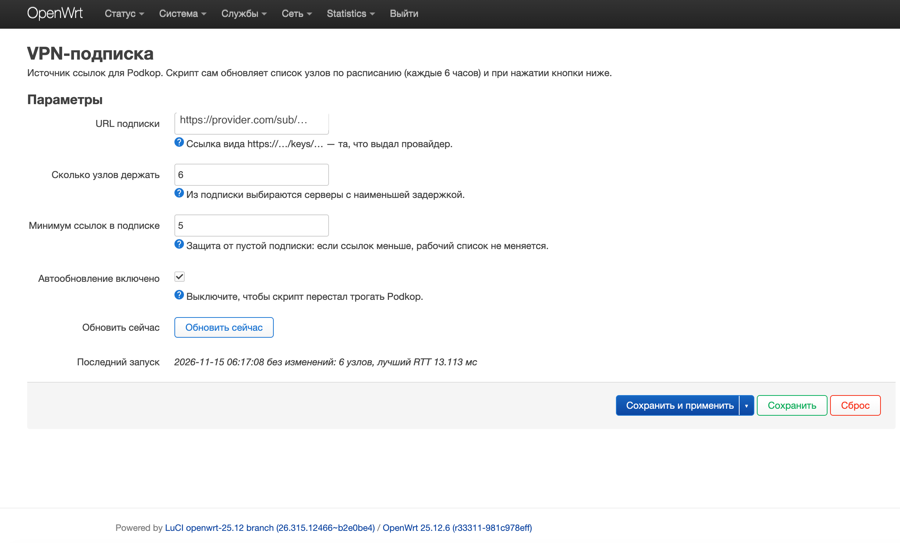

# podkop-subscription-addon

[](LICENSE)
[](https://github.com/Nubian353/podkop-subscription-addon/releases)
[](https://openwrt.org)
[](https://t.me/itdogchat/81758)

Аддон к Podkop: подписки, которых у него нет из коробки.

Автоматическое обновление узлов [Podkop](https://github.com/itdoginfo/podkop) из подписки на VPN, с управлением из LuCI.

Podkop не умеет работать с подписками: он принимает только отдельные ссылки (`vless://`, `ss://`, …). Этот проект закрывает разрыв — раз в несколько часов скачивает вашу подписку, выбирает ближайшие по задержке серверы и подставляет их в Podkop. Если один сервер умрёт, `urltest` переключится на другой.



<sub>Страница в LuCI (Службы → VPN-подписка). URL подписки на скриншоте заменён заглушкой.</sub>

```
подписка  →  ICMP-отбор кандидатов  →  проверка прокси  →  Podkop (urltest)  →  трафик
```

## Возможности

- Подписка меняется **в LuCI** — поле ввода, без SSH.
- Отбор по **реальной доступности прокси** (Clash API Podkop), а не по ping: узел, который пингуется, но не пускает трафик, в список не попадает.
- **Ручные узлы сохраняются**: ссылки, добавленные не из подписки, скрипт не трогает.
- **Защита от пустой/просроченной подписки**: если ссылок меньше заданного минимума, рабочий список не меняется.
- Кнопка «Обновить сейчас» и строка со временем последнего запуска.
- Работает на OpenWrt 24.10 и новее (apk и opkg).

## Чем отличается от других решений с подписками

Это не первый проект с подписками для Podkop — есть [luci-podkop-subscribe](https://github.com/mr-Abdrahimov/luci-podkop-subscribe), [obhodiq](https://github.com/renqismike/obhodiq) и другие. Отличия здесь не в количестве настроек, а в трёх решениях:

1. **Живость проверяется по-настоящему.** ICMP-пинг не годится: заблокированный сервер может пинговаться (и даже выигрывать по RTT), но не пускать прокси — блокировка сидит на TLS/SNI. Скрипт применяет кандидатов, ждёт, пока urltest их прощупает, и оставляет только тех, у кого Clash API вернул реальную задержку.
2. **Защита от пустой подписки.** Если ссылок пришло меньше `min_count`, рабочий конфиг не трогается — дом не остаётся без туннеля из-за истёкшей подписки или битого ответа.
3. **Не лезет в чужие настройки.** Меняется ровно один параметр Podkop — `urltest_proxy_links`. DNS, списки маршрутизации, другие секции и режимы остаются как были.

Плюс мелочи: понимает base64-подписки, имеет режим `--check` для проверки без изменений и внятно сообщает, если вместо подписки дали зашифрованную ссылку `happ://`.

**Чего здесь нет:** `vmess://`, `trojan://`, `ss://` (только `vless://`), отдельных правил на каждый узел и работы с несколькими подписками. Если это нужно — лучше подойдут другие проекты.

## Что делает установщик

`install.sh` не тянет ничего, кроме файлов из этого репозитория, и не отправляет телеметрию.

| Действие | Что именно |
|---|---|
| Проверяет | что это OpenWrt, есть ли `uci`, есть ли Podkop |
| Копирует | `podkop-sub-update.sh` → `/usr/bin/` (0755), страница LuCI, меню, ACL |
| Записывает | `/etc/config/podkop_sub` с URL подписки, права `600` |
| Добавляет | строку в `/etc/crontabs/root`: `17 */6 * * * /usr/bin/podkop-sub-update.sh` |
| Перезапускает | `cron`, `rpcd`, `uhttpd` |

Права, которые получает веб-интерфейс, ограничены: запуск одного скрипта и чтение одного статус-файла. Произвольные команды из UI выполнить нельзя.

Всё это можно проверить до запуска — файлы читаются, `install.sh` не обфусцирован.

## Проверено на

- **STELA VPN** — подписка отдаёт плоский список `vless://`-ссылок. Служебные записи, которые подмешивают панели («📆 Осталось: N дней», ссылки на `localhost`), отфильтровываются автоматически и не попадают в Podkop.
- Роутер: **Beeline SmartBox GIGA** (MediaTek MT7621, `mipsel_24kc`), OpenWrt **25.12.6**, Podkop **0.7.24** + `podkop-engine` **1.14.4-pdk-r25**.
- Замеры на этой связке: подписка 64 ссылки / 39 серверов, по ICMP отвечают 36, реально поднимаются 23. Итог — 12 узлов в ротации, у всех Clash API отдаёт задержку. Скорость узлов (20 МБ файлом): 76–122 Мбит/с.

Если запустили на другом провайдере или железе — напишите в issue, добавим в список.

## Требования

- OpenWrt **24.10+** с LuCI.
- Установленный **Podkop** (желательно с [`podkop-engine`](https://github.com/podkop-net/podkop-engine) — тогда работают и xhttp-узлы).
- Подписка, которая отдаёт `vless://`-ссылки списком (формат большинства панелей: 3x-ui, Marzban, Remnawave).

## Форматы подписок

| Формат | Поддержка |
|---|---|
| Обычный список `vless://…` в ответе | ✅ да |
| Список, закодированный в base64 (стандарт v2ray-подписок) | ✅ да, раскодируется автоматически |
| `happ://crypt4/…`, `happ://crypt5/…` | ❌ нет |

**Про HAPP.** В HAPP есть два вида доступа: обычная ссылка-подписка и зашифрованная `happ://crypt…`, где адрес подписки и конфиги скрыты ключом, встроенным в само приложение ([документация HAPP](https://www.happ.su/main/ru/faq/adding-configuration-subscription), [crypto link](https://www.happ.su/main/dev-docs/crypto-link)). Аддон на роутере зашифрованную ссылку не разбирает — и не должен: это контейнер для приложения, а не подписка. Если провайдер выдал `happ://…`, запросите у него **обычную ссылку-подписку** (обычно она есть в личном кабинете) — её аддон примет.

Содержимое подписки тоже может быть зашифровано провайдером (AES-128-GCM, заголовок `encrypt-tag`) — такой ответ аддон не читает и честно сообщит об ошибке.

## Установка одной командой

```sh
curl -fsSL https://raw.githubusercontent.com/Nubian353/podkop-subscription-addon/main/install.sh | sh -s -- --url "https://ВАША/ПОДПИСКА"
```

Без параметра `--url` установщик спросит ссылку интерактивно:

```sh
curl -fsSL https://raw.githubusercontent.com/Nubian353/podkop-subscription-addon/main/install.sh | sh
```

После установки:

1. Откройте **LuCI → Службы → «VPN-подписка»**.
2. Проверьте URL и число узлов, нажмите **Save & Apply**.
3. Нажмите **«Обновить сейчас»** — через полминуты Podkop начнёт работать через новые серверы.

## Параметры установщика

| Параметр | Значение по умолчанию | Описание |
|---|---|---|
| `--url URL` | — | Ссылка на подписку |
| `--top N` | `6` | Сколько серверов держать в Podkop |
| `--min N` | `5` | Минимум ссылок в подписке (ниже — не обновлять) |
| `--run` | спросит | Сразу применить список после установки |
| `--no-run` | спросит | Не применять сразу |

Примеры:

```sh
# 4 узла, без немедленного запуска
curl -fsSL https://raw.githubusercontent.com/Nubian353/podkop-subscription-addon/main/install.sh | sh -s -- --url "https://…" --top 4 --no-run

# локально из склонированного репозитория
git clone https://github.com/Nubian353/podkop-subscription-addon && cd podkop-subscription-addon && ./install.sh --url "https://…"
```

## Что и куда ставится

| Файл | Назначение |
|---|---|
| `/usr/bin/podkop-sub-update.sh` | сам скрипт обновления |
| `/usr/share/luci/menu.d/luci-app-podkop-sub.json` | пункт меню LuCI |
| `/usr/share/rpcd/acl.d/luci-app-podkop-sub.json` | ACL: право только на этот скрипт |
| `/www/luci-static/resources/view/podkop-sub/settings.js` | страница настроек |
| `/etc/config/podkop_sub` | настройки (права `600`: внутри URL подписки) |

Cron-запись добавляется в `/etc/crontabs/root`:

```
17 */6 * * * /usr/bin/podkop-sub-update.sh
```

## Как выбираются серверы

1. Скрипт скачивает подписку и выкидывает служебные ссылки (`localhost` — заглушки панелей вроде «осталось N дней»).
2. Оставляет по одной ссылке на хост, убирает дубликаты.
3. Пингует каждый сервер — это только порядок кандидатов, не критерий живости.
4. Применяет до 40 кандидатов и ждёт, пока Podkop их прощупает.
5. Спрашивает Clash API по каждому: оставляет только ответивших, сортирует по реальной задержке, берёт `top_n`.
6. Добавляет в конец ручные узлы (не из подписки) и применяет финальный список.

## Логи и диагностика

```sh
logread | grep podkop-sub          # история запусков
cat /tmp/podkop-sub.status         # последний результат
sh /usr/bin/podkop-sub-update.sh   # запустить вручную
sh /usr/bin/podkop-sub-update.sh --check   # только проверить подписку, ничего не меняя
```

Строка «Последний запуск» на странице настроек показывает тот же статус.

## Удаление

```sh
curl -fsSL https://raw.githubusercontent.com/Nubian353/podkop-subscription-addon/main/uninstall.sh | sh
```

Удаляет файлы, cron-запись и конфиг. Настройки самого Podkop (DNS, списки, режим) не трогаются.

## Безопасность

- URL подписки хранится в `/etc/config/podkop_sub` с правами `600` — как и любой доступ к VPN.
- ACL даёт веб-интерфейсу право **только** на запуск `/usr/bin/podkop-sub-update.sh` и чтение `/tmp/podkop-sub.status`. Произвольные команды из UI выполнить нельзя.
- Скрипт не меняет DNS, списки маршрутизации и другие секции Podkop — только список узлов (`urltest_proxy_links`).

## Ограничения

- Понимает `vless://` и `hysteria2://` (в открытом виде или в base64). `vmess://`/`trojan://` вытаскиваются, но не тестировались; `ss://` пропускается — PR приветствуются.
- Проверка живости занимает время: прогон с 40 кандидатами идёт около двух минут (с двумя перезапусками Podkop). Это раз в 6 часов, но синхронный вызов из LuCI тоже ждёт столько же.
- Подписка обновляется по расписанию раз в 6 часов; мгновенно — кнопкой «Обновить сейчас».

## Лицензия

MIT — см. [LICENSE](LICENSE).
